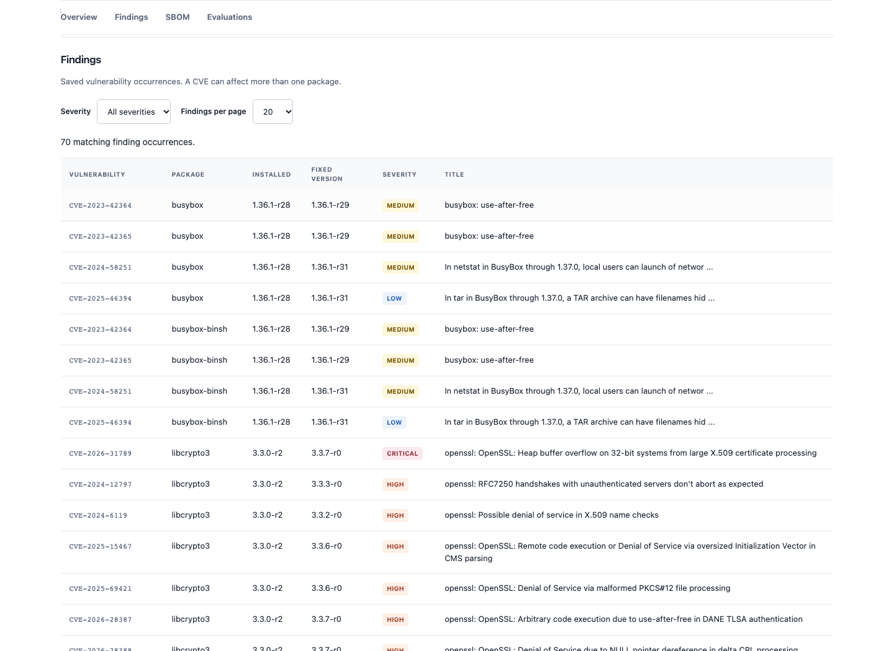
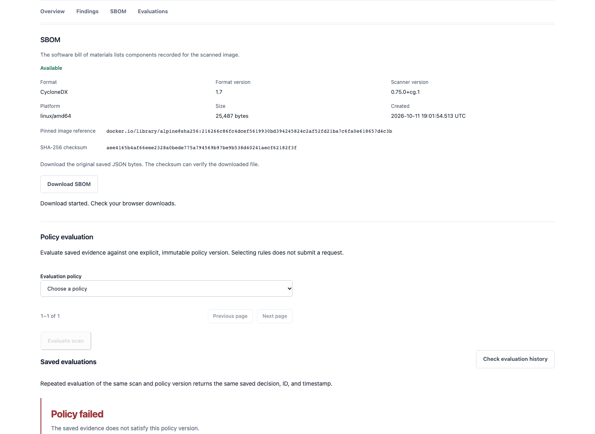
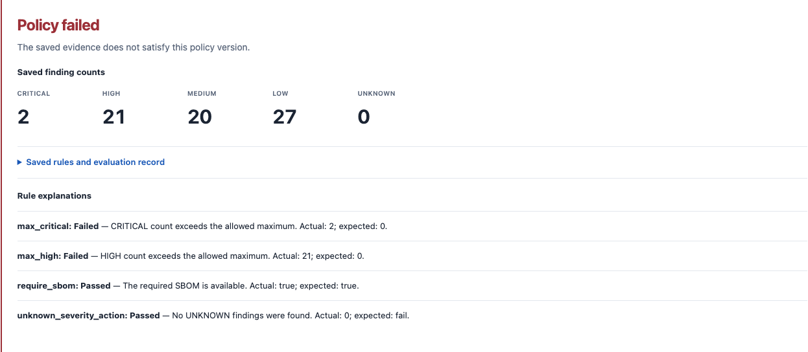
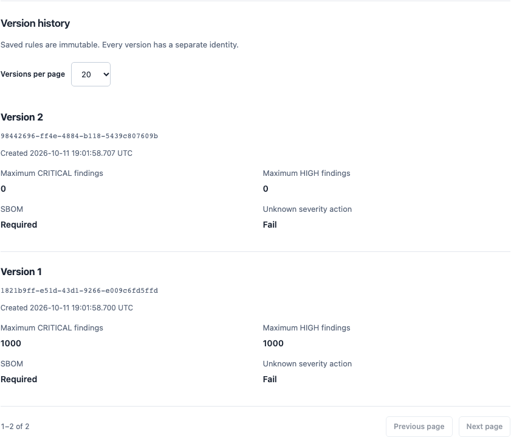

# Verification record

These observations were recorded on October 11, 2026, on Apple Silicon with
Docker Desktop. They describe this branch's local behavior, not a guarantee about
future vulnerability databases or production capacity.

## Scope and remaining work

An isolated source-only snapshot included the pending tracked and new branch
files, excluding Git metadata, local environments, ignored credentials, and
caches. All three linux/amd64 runtime images built from that snapshot. A separate
Compose project used fresh PostgreSQL, Redis, and Trivy cache volumes and ports
18080/18000/15433/16380. Development containers and volumes were not reused.
Application recreation preserved downloaded SBOM bytes.

The initial exercise below used an **uncommitted source snapshot**. A subsequent
committed clean-clone exercise and GitHub execution completed the remaining
verification checks; see the follow-up record below. No second developer has tried
this setup, so independent developer usability is not established.

## Committed checkout and GitHub follow-up

Commit `c61370bf57aebf98c00d0b52c0d43b6bb8e43cf8` was cloned from the remote
feature branch into a fresh verification directory. Its application images were
built and run with a unique Compose project, alternate ports, fresh volumes, and
an empty Trivy cache. The real browser workflow exercised findings, SBOM download,
policy versions, and saved evaluations. Scan
`b14bd5cc-4507-4ece-9599-953888e3cdff` completed with 70 findings, mock false,
and Trivy 0.75.0+cg.1. Its 25,487-byte SBOM had SHA-256
`c7e92ee25ffef75801b997cef4803b393a7f7c81d78ee41d84c902bb6bf75356`, also
verified after application recreation. Policy pass/fail results and repeated
immutable evaluation identity were checked. Only that project's resources were
removed; development volumes were preserved.

[Feature CI](https://github.com/christophervalle85/ContainerGuard/actions/runs/38173976883)
passed all six jobs, including the complete Linux installer, dependency/history
checks, and three runtime-image gates. The installed scanner was 0.75.0+cg.1;
no HIGH/CRITICAL findings or exceptions were reported in those passing gates.
[Main CI](https://github.com/christophervalle85/ContainerGuard/actions/runs/38174484043)
also passed at merge commit `ceacf5cd497048ebb9c443ed6aefaa617cdf1606`.

The disposable [demonstration PR #10](https://github.com/christophervalle85/ContainerGuard/pull/10)
then verified workflow rejection without modifying test expectations, gate rules,
or exceptions. Commit `da3c450284f8c08f38b3797ec40db459ee1b29b3` deliberately
changed the health response and restored the previous pinned Debian API base.
[Red CI](https://github.com/christophervalle85/ContainerGuard/actions/runs/38181249064)
failed two health-response tests while 823 passed. The API image built and scanned
successfully, then the gate exited 1 with 64 HIGH and 5 CRITICAL findings and no
exceptions. The other four jobs passed. Commit
`55eb37d4d01a66f42d7a77da646fcb77f5ea3b53` restored both files exactly to main.
[Restoration CI](https://github.com/christophervalle85/ContainerGuard/actions/runs/38181629578)
passed all six jobs. The demonstration PR was closed without merging.

The restored local suite passed 825 tests, lint, and formatting. The 47 focused
security tests also passed, including unsuccessful scanner execution, timeout,
missing/invalid reports, wrong scanner version, and stale-report rejection through
the same runner used in CI. These negative fixtures establish failure behavior;
they do not replace the real image gate demonstration above.

These are recorded verification results with retained source/run links, not a second
developer's independent setup test. Live findings and database timestamps can
change on later scans. No ContainerGuard release had been published during this
exercise; the published-release verification is recorded below.

## Checks

- Backend lint and formatting passed. The final complete suite passed 825 tests.
- Frontend lint, formatting, types, build, 181 unit tests, and 14 browser tests passed.
  Browser regression tests use intercepted fixture responses.
- A separate real browser session navigated actual saved findings, downloaded the
  SBOM, submitted an evaluation of an explicit version, and viewed both policy
  versions. Its screenshots are under `docs/images/`.
- Gate/runner tests exercise clean, blocked, absent, malformed, wrong-target,
  timed-out, unsuccessful, and stale reports, plus invalid/expired exceptions.
  Installer tests reject unsupported platforms and a corrupted archive before
  installing a binary. Fake scanners are deliberately fictional.
- A real redacted Gitleaks 8.30.1 history scan found no secrets in the 16 reachable
  commits at the branch base. A separate scan of the pending source-only snapshot
  also found no leaks. A temporary repository containing a synthetic token
  triggered detection without printing the token. Pending changes become part of
  reachable history only after commit; CI must scan that commit again.
- Native ARM64 API/worker builds succeeded; worker imports and the patched scanner's
  version command passed. The full runtime exercise used linux/amd64 images under
  emulation, matching the CI image platform.

Run the commands in the [README](../../README.md#run-the-checks) to repeat checks.
Tests use dedicated PostgreSQL/Redis services and disposable schemas/queues.

## Vulnerability gate and remediation

The initial Debian 12 runtime scan reported 69 blocking API findings and 73
blocking worker findings. The frontend had one blocking finding. A Debian 13
trial still had 52 HIGH findings. The threshold remained HIGH/CRITICAL, including
unfixed findings. No exceptions were added.

The selected images use pinned Alpine Python, omit runtime pip, and rebuild
Trivy 0.75.0 from checksum-pinned source with Go 1.27.2 and x/net 0.60.0. The
patched binary identifies itself as `0.75.0+cg.1`. Nginx's TIFF/zlib runtime
packages are updated during build. This introduces downstream scanner maintenance;
see [containers](../architecture/containers.md#resource-bounds-and-scanner-maintenance).

Final local linux/amd64 image scans with host Trivy 0.75.0 and a refreshed database:

| Target | HIGH / CRITICAL | Other findings | Result |
| --- | --- | --- | --- |
| API | 0 / 0 | zlib CVE-2026-85091, MEDIUM; fix 1.3.2-r1 | Pass |
| Worker | 0 / 0 | same zlib MEDIUM; x/crypto GO-2026-5932 UNKNOWN, no listed fix | Pass |
| Frontend | 0 / 0 | None reported | Pass |
| Both lockfiles | 0 / 0 | None reported | Pass |

The lockfile scan recognized 38 uv packages and 263 npm packages, including
development dependencies. The local runner accepts reviewed upstream 0.75.0 and
patched 0.75.0+cg.1; CI installs the patched build exported from Dockerfile.worker.
A passing threshold is not a vulnerability-free assertion. UNKNOWN remains visible.
Builder stages and PostgreSQL/Redis images are outside this runtime gate.

## Real scan, artifact, and policies

The disposable stack scanned `docker.io/library/alpine:3.20.0`, resolved to:

```text
sha256:216266c86fc4dcef5619930bd394245824c2af52fd21ba7c6fa0e618657d4c3b
```

Scan `e101c6fe-e0fa-49f8-8887-250b34841da3` completed with `mock: false`,
platform linux/amd64 and scanner 0.75.0+cg.1. It recorded 70 occurrences:
2 CRITICAL, 21 HIGH, 20 MEDIUM, 27 LOW, and 0 UNKNOWN. Vulnerability database
UpdatedAt was `2026-10-11T13:06:05.155544028Z`.

Its available CycloneDX 1.7 artifact was 25,487 bytes. Downloaded bytes matched
saved SHA-256 `aee4165b4af66eee2328a0bede775a794569b97be9b538d40241aecf62182f3f`,
including after API/worker/frontend recreation. The real browser download was
checked separately. These IDs identify disposable evidence, not records expected
in another developer's installation; timestamps and hashes vary on new scans.

A permissive demonstration policy version (max critical/high 1000, required SBOM,
unknown severity fails) passed. A new version with both maxima zero failed with
explained critical/high count breaches. Repeating the original evaluation returned
the same saved ID, timestamp, and rule snapshot. The deliberately permissive
version demonstrates versioning; it is not a recommended release policy.






## Resource and failure observations

Docker HostConfig confirmed the CPU/memory/PID limits in
[containers](../architecture/containers.md#resource-bounds-and-scanner-maintenance).
Redis reported maxmemory 134217728 bytes and noeviction. A fresh-cache real scan
ran from 19:01:44.601 UTC to 19:01:54.515 UTC, including a database download.
Five samples taken during submission/processing observed these maxima:

| Service | Sampled memory maximum | Sampled CPU maximum |
| --- | ---: | ---: |
| API | 103.5 MiB | 0.24% |
| Worker | 274.5 MiB | 100.89% |
| Redis | 12.34 MiB | 0.98% |
| Frontend | 25.32 MiB | 1.12% |

Docker CPU percentages use one logical core as 100%. Sampling can miss peaks;
these values are not minimum requirements or load-test results. Docker/network
caches and the small submitted image affect elapsed time and resource use.

With only the disposable worker stopped, temporarily setting that Redis service's
maxmemory to one byte made submission return 503 with `Scan queue temporarily
unavailable`. The configured limit was restored before restarting the worker.
Integration tests separately check that known enqueue failures save failed state.
No memory limit was changed on the development or shared test Redis services.

Real PostgreSQL concurrency tests cover the last-slot race and lock timeout.
Retries, recovery, interrupted enqueue gaps, terminal capacity release, invalid
startup configuration, safe 422/429 responses, and actual RQ stored tracebacks/logs
have targeted coverage. No live job was killed to manufacture interruption.

## Repeating isolated setup

Use a clean clone after the branch is committed. Copy `.env.example` to a local
verification env file, choose a unique Compose project, and change all published
ports. Update host database/Redis URLs to match; container URLs still use db/redis.
From that clone:

```bash
docker compose --env-file .env.verify -p containerguard-verify up -d --build
docker compose --env-file .env.verify -p containerguard-verify ps -a
```

Follow [the demo](../demo.md), then recreate application containers and repeat the
SBOM download/checksum comparison. Record your commit, versions, results, and CI
links. Remove only this verification project's resources afterward:

```bash
docker compose --env-file .env.verify -p containerguard-verify down --volumes
```

That last command deletes the verification project's saved scans and cache. Never
run it with the normal development project name when you intend to retain data.

## Independent review

The final independent review inspected tracked changes and new untracked files
against base `c4c597900f9ec8756faa9434c5aae1af1d385552`. It found one Important
issue: standalone security scripts initially used Python 3.14-only exception
syntax, while Ubuntu 24.04 CI invokes Python 3.12. A failing grammar regression
reproduced it; parenthesized exception tuples and a per-file Ruff target fixed it.
The reviewer independently checked the repair. No Critical, Important, or Minor
issues remain from that review. The reviewer did not independently rerun the
service-backed suites or image builds.

The review used these explicit scope boundaries, with no deferred code fixes:

- Public deployment/authentication/authorization stay outside this localhost work.
- Distributed execution limits stay outside the supported one-worker deployment.
- Automatic reconciliation and transactional outbox delivery remain future work;
  the documented enqueue gap and manual recovery remain.
- Exactly-once execution is not promised.
- Historical database/AOF/cache/layer disk growth remains an operator responsibility.
- Builder stages and database/Redis service images remain outside the runtime gate.
- LOW/MEDIUM/UNKNOWN remain visible; only HIGH/CRITICAL block this approved gate.
- Complete sandbox isolation and safety of every submitted image are not claimed.
- Signing, provenance, publication, and independently reproducible scanner binaries
  remain deferred; the current downstream build has an ongoing maintenance cost.
- Deliberate contributor changes to CI or exceptions require repository review.
- Broad accessibility certification, load capacity, and large-image sizing are not
  established by targeted browser checks and a sampled small-image run.

Synthetic gate reports live in test builders rather than duplicate JSON fixtures.
The configured scanner deadline has no extra grace period. The complete Linux
installer passed in GitHub CI. Application containers never received Docker's
socket.

Only verification-owned containers, volumes, and network were removed. The isolated
worker passed its health checks. A later development-worker check found a live
heartbeat but missing RQ registration fields, including state. The original cause
of that metadata loss was not established. With no waiting or started jobs, a
graceful worker restart restored its PID, hostname, idle state, and passing health
probe. A real scan (`959dea6c-44f5-481d-874f-59f6c7d66ca3`) then completed with
70 findings, mock false, and an available SBOM. That existing deployment still
uses upstream Trivy 0.75.0; the separate patched-image verification above used
0.75.0+cg.1. No development volumes were removed or saved jobs edited.


## Versioned-image release preflight

The complete release-candidate command passed locally from an uncommitted working
copy. This verifies the implementation, not the provenance of a published version.
All three linux/amd64 images passed vulnerability and disclosure checks before
archive export. The resulting handoff was independently revalidated against the
archive/configuration/manifest/layer identities and sealed check evidence. The
local API report contained one MEDIUM finding; the worker contained one MEDIUM
and one UNKNOWN finding; the frontend had none. These are observations from this
database snapshot, and passing the gate does not mean zero vulnerabilities.

A fresh, separately named Compose stack completed scan
`f944a174-f142-41b8-b680-25d222816a29` with 70 real findings using Trivy
0.75.0+cg.1. Its SBOM SHA-256 was
`f6406d45e3ab155a5ad941f9993c111da701b8edf2113967a28eedd79894ef3f`.
Policy evaluation and downloaded artifact bytes survived application recreation.
Only verification-owned resources were removed, and no containers or volumes with
the verification prefix remained afterward. Development data was not reused.

Backend verification passed 951 tests with the pinned scanner integration probes
enabled. Frontend checks passed 181 unit tests and 14 browser tests, along with
lint, formatting, types and the production build. Python lint/formatting,
actionlint and patch whitespace checks passed. Focused regressions cover rejected
source identities, altered archives/evidence, bounded tar extension headers,
occupied tags, failures at every upload position and unsafe redirect destinations.
An anonymous read of a public GHCR image verified its redirected configuration
and digest. Both classic and containerd Docker identity behavior are covered;
manifest/configuration IDs are kept distinct and tied to the same payload.

Initial disclosure checks blocked public dependency material. Investigation
located two SQLAlchemy expressions and 18 embedded Trivy values: module checksums,
public policy examples and packed detector strings. The maintainer approved the
20 exact-value exceptions now recorded in `security/gitleaks.toml`. All default
rules remain active, with no file/directory exclusions. Twelve pinned-detector
tests passed, including generated credentials for every affected rule and the
existing encoded, binary-adjacent, later-deleted and metadata probes. No raw match
reports were retained in the release handoff.

No images, tags or GitHub Release were published during this local preflight.
The subsequent tagged run exercised Linux release execution, first-package
authorization with GITHUB_TOKEN, public package access and anonymous installation;
see the published-release record below. Candidate/publisher job limits are execution
budgets, not a promise that every operation's maximum deadline can be exhausted.
Runner interruption can prevent cleanup or retention of a partial-upload record;
inspect all six destinations before attempting a new version, and never overwrite
a partially published version. No second developer has independently tried setup.

## Published-release verification

[ContainerGuard v0.1.0](https://github.com/christophervalle85/ContainerGuard/releases/tag/v0.1.0)
was published on October 12, 2026, at 05:05:10 UTC. It identifies source commit
`b8a0e05a4313a7159d061e8aa240ffe8dff3aae3`. The
[release workflow](https://github.com/christophervalle85/ContainerGuard/actions/runs/38203141835)
passed quality checks, the complete candidate exercise, exact-image publication
and draft creation. Its first attempt stopped before backend tests because the
public registry refused a PostgreSQL pull with a data-limit error. Retrying the
failed jobs succeeded without changing the tag, source or gate thresholds.

Published application images:

| Service | Registry digest |
| --- | --- |
| api | `sha256:1a01e5cc690949c5c922167abcce3d2df6972ab96ca36687ee42671e868971c4` |
| worker | `sha256:03aea90eae4ee02917df913c3e18a1297fcd69916a2169fa6cc5ea9474091cf3` |
| frontend | `sha256:a910d661289a28f1713f7fb930ca87e5b8b0243389216a582728a679b3d1193c` |

Each digest belongs to its corresponding
`ghcr.io/christophervalle85/containerguard-{api,worker,frontend}` package.
Anonymous manifest reads and exact-digest Docker pulls verified public access.
A fresh verification project used empty Docker authentication, random localhost
ports and separate storage; no application images were rebuilt.

Scan `8d25326f-703c-48f4-be33-2331fd8400eb` completed with 70 real
findings using Trivy `0.75.0+cg.1`. Its SBOM SHA-256 was
`809f9d174c718323ce04a8de69b864da265c9e6bb5a749cf7154abd58ff9e4ee`.
Downloaded bytes matched the recorded checksum. Permissive and strict policy
evaluations returned the expected outcomes, duplicate evaluation identity stayed
unchanged, and stored scan/evaluation/SBOM evidence survived application recreation.
The verification command exited successfully and removed only its own containers
and volumes. Development data was preserved.

After publication, the release page and both assets were anonymously accessible.
Asset SHA-256 values:

- `release.json`: `e69f517089ebe5425e18c669d33d1ad18b30d61236e6b1e0a653c317c818af11`.
- `compose.release.yaml`: `a958e24cb412fda00750dbb5eca132be59fb8febcf57615d4037e2127fde47eb`.

Application runtime reports retained one MEDIUM finding in the API, one MEDIUM
and one UNKNOWN in the worker, and none in the frontend. Counts are dated
observations. This release has no Cosign signatures, release-image SBOMs or
verified build provenance, and no independent second-developer installation is
claimed. PostgreSQL, Redis and builder images remain outside the application
runtime vulnerability gate.
